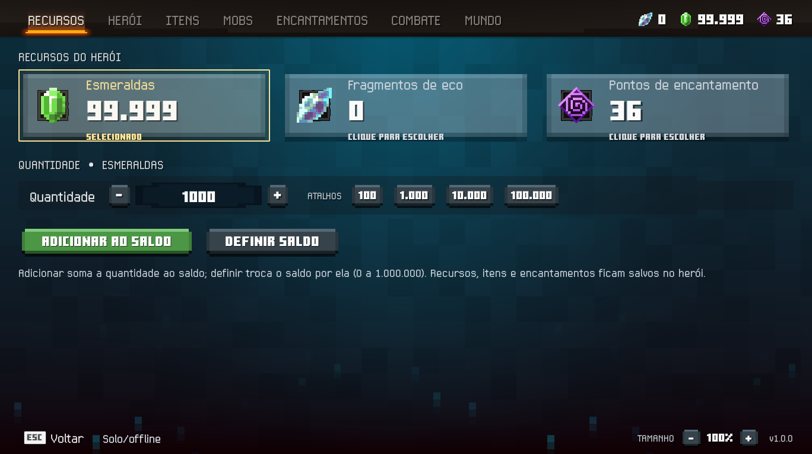
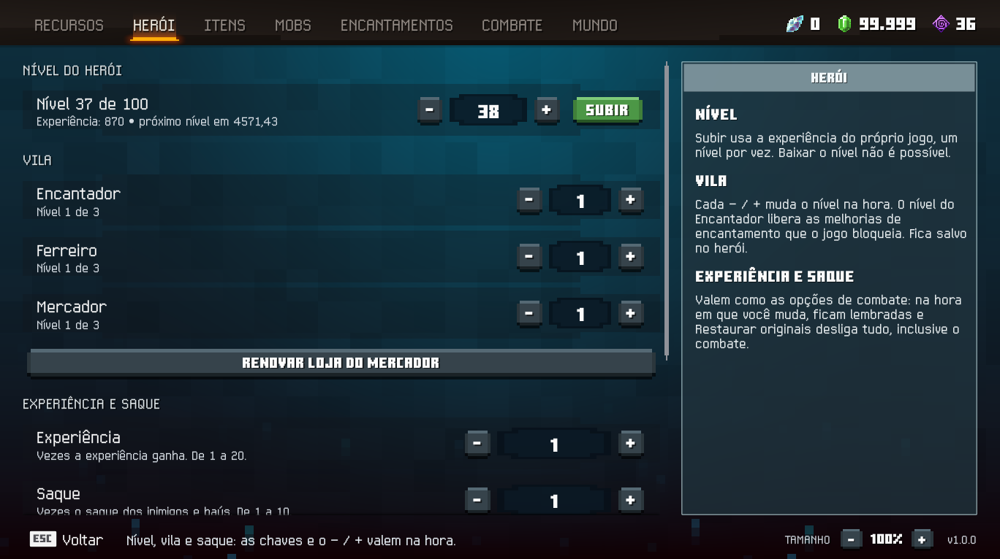
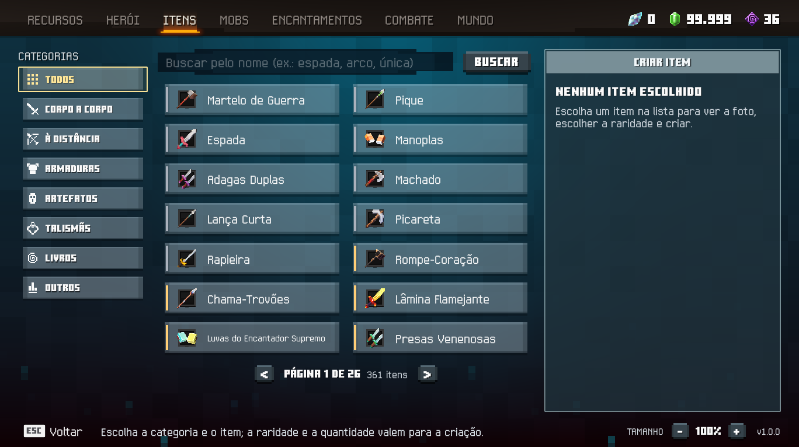
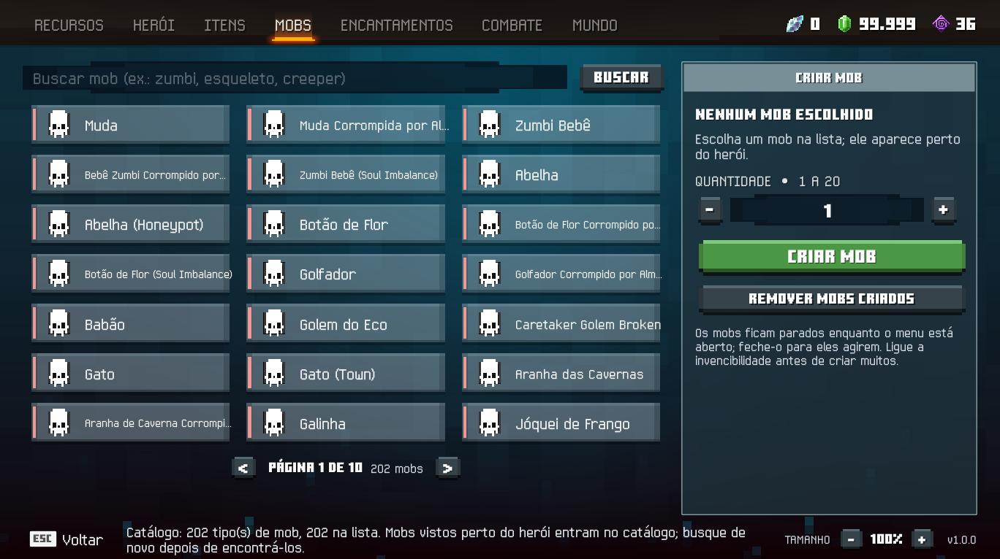
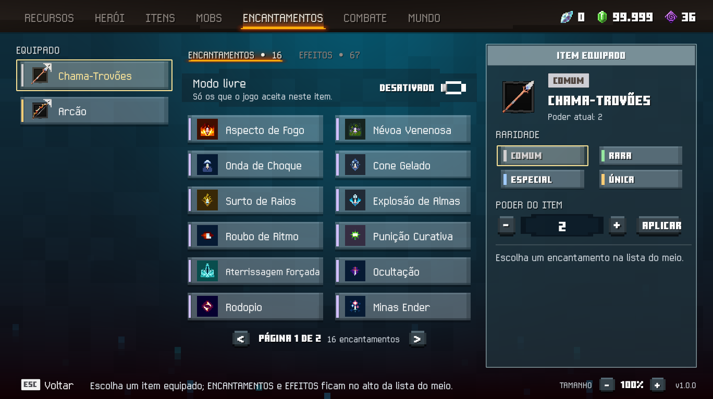
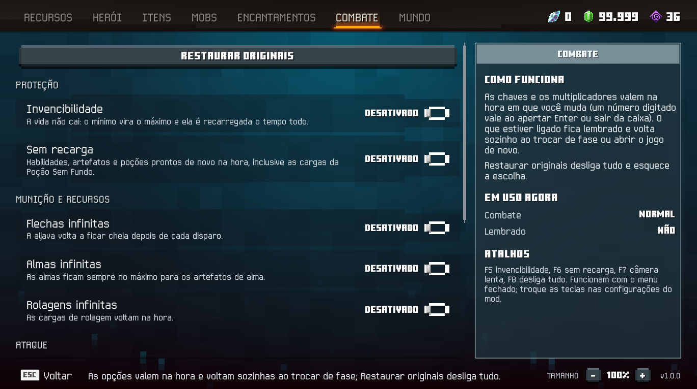
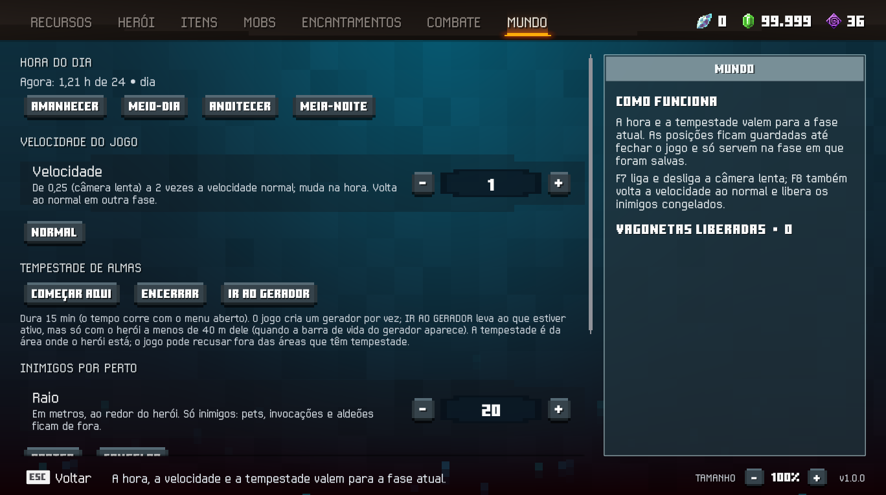
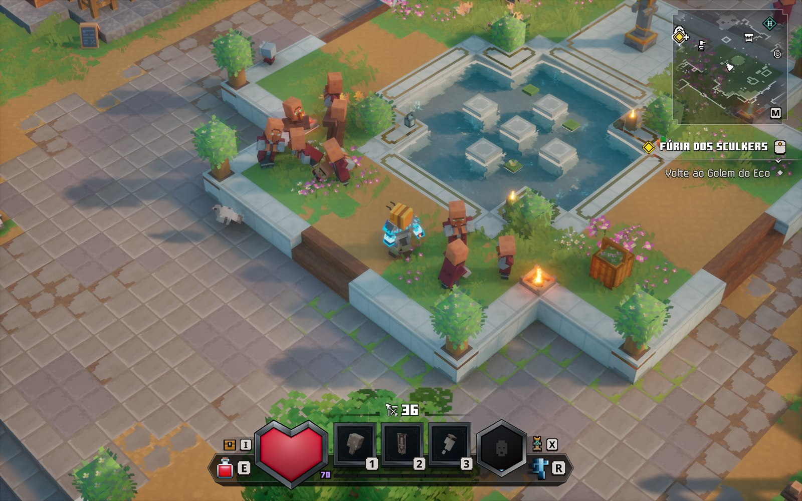
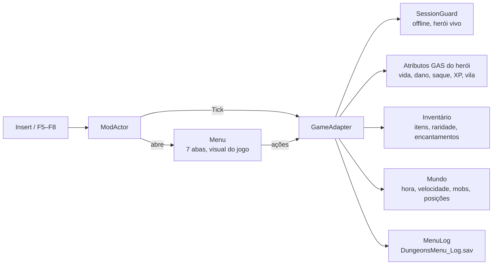

<div align="center">

# Menu Solo — Minecraft Dungeons II

**Um menu de trapaças em português, com o visual do próprio jogo, para partidas solo/offline.**


-2ea44f)




</div>

---

## Sumário

- [O que é](#o-que-é)
- [Abas do menu](#abas-do-menu)
- [Atalhos](#atalhos)
- [Instalação](#instalação)
- [Uso](#uso)
- [Segurança e limites](#segurança-e-limites)
- [Como funciona por dentro](#como-funciona-por-dentro)
- [Compilar e testar](#compilar-e-testar)
- [Diagnóstico](#diagnóstico)
- [Estrutura do repositório](#estrutura-do-repositório)
- [Limitações conhecidas](#limitações-conhecidas)
- [Créditos e licença](#créditos-e-licença)

## O que é

O **Menu Solo** é um mod para **Minecraft Dungeons II** (Steam, versão 1.1.3.0). Ele abre com **Insert** por cima do jogo e reúne, em sete abas, o que normalmente exigiria horas de farm: recursos, nível, itens, mobs, encantamentos, combate e controle do mundo.

- Escrito em C# e compilado para Blueprint com o [NeoRuneExtended](https://github.com/thororen1234/NeoRuneExtended); carregado pelo [Blueprint Loader](https://www.nexusmods.com/minecraftdungeons2/mods/2) oficial, de ewanhowell5195.
- Usa as peças visuais do próprio jogo: abas com a linha laranja, botões verdes de confirmar, interruptores e molduras da tela de Configurações, ícones de itens e categorias.
- Cada ação mostra no rodapé **o que o jogo respondeu**, e não só o que foi pedido.
- Só funciona **solo/offline**. O jogo é aberto normalmente pelo Steam.

## Abas do menu

### Recursos

Adicione ou defina **esmeraldas**, **fragmentos de eco** e **pontos de encantamento** (0 a 1.000.000), com atalhos de 100 a 100.000. Os saldos aparecem também no canto da barra de abas, como no jogo.

### Herói



| Função | Como funciona |
|---|---|
| **Subir nível** | Usa a experiência do próprio jogo, um nível por vez, para o jogo fazer a subida dele. Baixar não é possível |
| **Vila** | Nível do **Encantador**, do **Ferreiro** e do **Mercador** até o máximo do jogo; o − / + muda o nível na hora. O Encantador libera as melhorias de encantamento que o jogo bloqueia |
| **Renovar loja do Mercador** | Renova o estoque do Mercador pelo próprio jogo, de graça e de qualquer lugar do mapa (testado: a troca foi usada e nenhuma esmeralda foi cobrada) |
| **Experiência e saque** | Multiplicador de experiência, multiplicador de saque, **raridade máxima**, **drop garantido** e **saque duplicado** |
| **Baús da Tempestade de Almas** | Eles ignoram o multiplicador de saque; com **Saque ×N**, cada equipamento que sai de um baú ganha N−1 cópias no inventário |

Com a raridade máxima ligada, equipamentos comuns e raros viram **Especiais** já no chão e também ao entrar no inventário. Itens únicos continuam únicos.

### Itens



Catálogo com os mais de 360 itens que o herói pode ter, separados por categoria (corpo a corpo, à distância, armaduras, artefatos, talismãs, livros), com busca pelo nome em português, ícone do jogo, **raridade** (comum, rara, especial, única) e quantidade de 1 a 20.

**Talismãs:** cria no nível 1 a 3 e muda o nível de um que o herói já tem; o painel mostra o efeito daquele nível.

### Mobs



Cerca de 200 tipos de mob, com busca e páginas, pelos nomes do jogo. Os mobs nascem perto do herói, montados pelo sistema de tipos do próprio jogo para virem com aparência, habilidades e IA. **Remover mobs criados** apaga só os que o menu criou.

### Encantamentos



- Escolha o item equipado e um dos encantamentos que o jogo aceita naquele item. Se o livro faltar, o menu cria. As melhorias respeitam os pontos e o nível do Encantador, e o rodapé diz por que o jogo recusou, quando recusa.
- **Remover encantamento** usa o desencantar do próprio jogo.
- **Raridade e poder** do item equipado, inclusive itens comuns.
- **Modo livre**: qualquer encantamento em qualquer item, até o nível 20 (acima do máximo normal, o efeito em combate não foi medido).
- **Modo EFEITOS**: adiciona, troca o nível (até 10) ou remove os efeitos de armas, armaduras e **artefatos** equipados. Acima do nível 3 a dica do jogo continua mostrando o valor do nível 3, mas o efeito usa o nível escolhido.

### Combate



| Grupo | Opções |
|---|---|
| Proteção | **Invencibilidade**; **sem tempo de recarga** (habilidades, artefatos, poções e as cargas da Poção Sem Fundo) |
| Munição e recursos | **Flechas infinitas**, **almas infinitas**, **rolagens infinitas** |
| Ataque | **Crítico sempre**, dano (1–100×), velocidade de ataque, dano crítico |
| Movimento | Velocidade de movimento, altura do pulo |

Tudo vale na hora em que você muda, sem botão de aplicar (um número digitado vale ao apertar Enter ou sair da caixa), e fica **lembrado**: volta sozinho ao trocar de fase, ao reabrir o jogo e depois que o herói morre e renasce. **Restaurar originais** desliga tudo e esquece a escolha.

### Mundo



| Função | Detalhe |
|---|---|
| **Hora do dia** | Amanhecer, meio-dia, anoitecer e meia-noite |
| **Velocidade do jogo** | De 0,25× (câmera lenta) a 2×; volta ao normal em outra fase |
| **Tempestade de Almas** | Começa ou encerra a tempestade na área do herói; **IR AO GERADOR** leva ao gerador ativo quando ele está a menos de 40 m (a barra de vida dele aparece) |
| **Inimigos por perto** | **Abater** (morrem e soltam saque) ou **congelar/liberar** num raio de 5 a 50 m. Pets, invocações e aldeões ficam de fora |
| **Posições** | Três posições para salvar e voltar, na mesma fase |
| **Vagonetas** | Lista das estações já liberadas, com os nomes do mapa |

## Atalhos

Funcionam com o menu fechado e mostram um aviso no canto da tela. As teclas podem ser trocadas em **Configurações → Mods → Menu Dungeons — Solo**.

| Tecla | Ação |
|:---:|---|
| `Insert` | Abre e fecha o menu (`Esc` também fecha) |
| `Q` / `E` | Aba anterior / próxima |
| `F5` | Liga/desliga a invencibilidade |
| `F6` | Liga/desliga o sem tempo de recarga |
| `F7` | Liga/desliga a câmera lenta |
| `F8` | Desliga tudo: combate, câmera lenta e inimigos congelados |

<div align="center">

</div>

## Instalação

> [!WARNING]
> O que você altera em Recursos, Herói, Itens e Encantamentos **fica salvo no herói**, e subir o nível não pode ser desfeito. Nos testes, restaurar um backup **não** desfez alterações já salvas pelo jogo. Se não quiser arriscar, use um herói descartável.

1. Instale o [**Blueprint Loader**](https://www.nexusmods.com/minecraftdungeons2/mods/2) como explica a página dele (a pasta `BlueprintLoader` vai dentro de `Dungeons\Content\Paks\~mods`). Use só esse loader: vindo da 0.3.x, que trazia o BetterBlueprintLoader, rode antes o `Remover.ps1` da pasta antiga.
2. Baixe o ZIP da versão em **Releases** (`DungeonsMenu-1.0.0.zip`). Ele traz o mod compilado e os scripts.
3. Extraia para uma pasta **permanente**, fora da pasta do jogo e fora de `Dungeons2\Saved`. Essa pasta guarda o registro da instalação e os seus backups.
4. Com o jogo fechado, abra o PowerShell nessa pasta:

```powershell
powershell -NoProfile -ExecutionPolicy Bypass -File .\Instalar.ps1 -Verificar
powershell -NoProfile -ExecutionPolicy Bypass -File .\Instalar.ps1
```

5. Abra o jogo normalmente pelo Steam.

Opcional: o `Iniciar-Mod.ps1` confere a versão do executável, faz um backup verificado dos saves e pede ao Steam para abrir o jogo:

```powershell
powershell -NoProfile -ExecutionPolicy Bypass -File .\Iniciar-Mod.ps1
```

O caminho padrão do jogo é `C:\Program Files (x86)\Steam\steamapps\common\Minecraft Dungeons II`. Para outra biblioteca do Steam, use `-GamePath 'caminho completo'` nos scripts.

**Para remover**, com o jogo fechado, na mesma pasta:

```powershell
powershell -NoProfile -ExecutionPolicy Bypass -File .\Remover.ps1
```

O instalador só remove os arquivos que continuam com o mesmo hash e devolve o que havia antes. Remover o mod não desfaz o que o jogo já salvou.

## Uso

1. Entre com o herói numa partida offline e espere o mapa carregar.
2. Aperte **Insert**.
3. Escolha a aba, ajuste e confirme. O rodapé mostra a resposta do jogo.

Dicas:
- Antes de criar muitos mobs, ligue a invencibilidade.
- Os mobs ficam parados enquanto o menu está aberto; feche-o para eles agirem.
- Para melhorar encantamentos, adicione pontos na aba Recursos e suba o Encantador na aba Herói.
- Os botões **−** e **+** do rodapé ajustam o tamanho do menu (80% a 130%).

## Segurança e limites

O menu só altera alguma coisa quando todas estas condições valem:

- a partida é solo/offline, sem cooperativo local;
- há um herói vivo e o mapa terminou de carregar.

Os efeitos de combate são temporários e guardam os valores originais: ao desligar, o menu só devolve um atributo se ele ainda estiver com o valor que o menu deixou, para não sobrescrever o que o jogo mudou por conta própria (equipamento, nível, morte).

## Como funciona por dentro



| Arquivo | Papel |
|---|---|
| `ModActor.cs` | Ponto de entrada: teclas (Insert, F5–F8), abre o menu, faz o tick do adaptador |
| `Menu.cs` | A interface: as sete abas, grades, painéis de detalhe, interruptores e botões |
| `GameAdapter.cs` | Toda a conversa com o jogo: atributos, inventário, mobs, encantamentos, mundo; restauração e opções lembradas |
| `ItemVisuals.cs` / `ButtonLook.cs` | Ícones, nomes em português, fontes e estilos de botão lidos do próprio jogo |
| `Rules.cs` / `CombatRecoveryRules.cs` | Limites e regras puras, testadas fora do jogo |
| `SessionGuard.cs` | Bloqueia alterações fora do modo seguro |
| `MenuLog.cs` | Log de diagnóstico com as 300 linhas mais recentes |

Alguns detalhes que só apareceram testando em partida:

- O jogo ignora a raridade pedida ao criar itens, então o menu grava a raridade direto no item. É o mesmo campo que o jogo usa nas dicas e no save.
- Mobs criados com o tipo vazio ficavam invisíveis e parados. O menu define o tipo do mob antes de terminar de criá-lo.
- Alguns "multiplicadores" do jogo são bônus somados que começam em 0 (como o de saque), então o menu soma em vez de multiplicar.
- Ao morrer, o herói volta com os atributos padrão do jogo, e o menu reaplica as opções lembradas quando ele renasce.

## Compilar e testar

Requisitos: **.NET SDK 10** e acesso ao NuGet (pacote `NeoRuneExtended.Sdk/1.0.0`).

```powershell
.\tools\build.ps1
```

O script compila o mod e roda as verificações de regras. Os arquivos gerados ficam em `dungeons-menu/bin/NeoRune/Pak`: o build não copia nada para o jogo. Para os testes do instalador, que rodam só em pastas de teste e não tocam no jogo:

```powershell
powershell -NoProfile -ExecutionPolicy Bypass -File .\package-scripts\Test-Package.ps1
```

Estado atual: **66** verificações de regras e **119** verificações do instalador passando.

## Diagnóstico

O menu grava as mensagens do rodapé e os passos internos em:

```
%LOCALAPPDATA%\Dungeons2\Saved\SaveGames\DungeonsMenu_Log.sav
```

Para ler:

```powershell
python -I .\tools\read-menu-log.py 100
```

O arquivo não contém credenciais. Linhas `[diag]` mostram o que o jogo devolveu (por exemplo `tweak MeleeAttackSpeed 1.0->2.5`); linhas `[menu]` são as mensagens do rodapé; `[hotkey]` são os atalhos.

## Estrutura do repositório

```
├── dungeons-menu/        código do mod (C# → Blueprint)
├── validation-tests/     verificações das regras, fora do jogo
├── package-scripts/      instalador, iniciador, remoção, backup e seus testes
├── tools/                build.ps1 e read-menu-log.py
├── docs/images/          capturas de tela
├── CHANGELOG.md          histórico de versões
├── THIRD-PARTY.md        componentes de terceiros
└── LICENSE               MIT
```

## Limitações conhecidas

- **Modo livre acima do máximo:** o item guarda o nível e a força pedidos, e eles continuam no save. O efeito em combate não foi medido, e a dica do jogo mostra o nível III.
- **Efeitos acima do nível 3:** agem com a força escolhida (uma recarga de 4 s caiu para 3,1 s no nível 3 e para 1,7 s no nível 10), mas a dica do jogo continua mostrando o valor do nível 3.
- **Mobs:** todos aparecem com o mesmo ícone. Um tipo (o coelho-geleia de alma) só pode ser criado depois de visto perto do herói.
- **Raridade máxima:** o feixe de luz dos drops no chão continua com a cor sorteada pelo jogo, mesmo com o item já Especial.
- **Versão do jogo:** o instalador e o iniciador só aceitam a versão 1.1.3.0. O menu em si não confere a versão: depois de uma atualização do jogo ele continua instalado, mas pode falhar se a atualização mudar algo que ele usa.

## Créditos e licença

- Código do menu, scripts e testes: **MIT** (veja [`LICENSE`](LICENSE)).
- [NeoRuneExtended](https://github.com/thororen1234/NeoRuneExtended) (MIT) e [Blueprint Loader](https://www.nexusmods.com/minecraftdungeons2/mods/2), de ewanhowell5195: veja [`THIRD-PARTY.md`](THIRD-PARTY.md).
- Criação assistida por Codex e Claude Code.

<sub>Minecraft Dungeons II pertence aos respectivos titulares. Este projeto não é afiliado nem endossado pela Mojang Studios ou pela Microsoft. Use por sua conta e risco, só em partidas solo.</sub>
